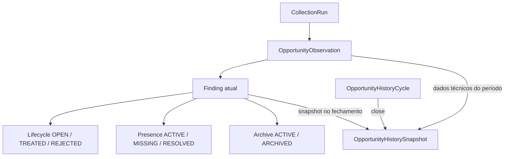

# Fase 24 — arquitetura integrada e readiness

Este documento consolida os contratos transversais introduzidos pelas Tasks 24.1–24.12. Os documentos especializados continuam sendo a referência detalhada de cada módulo; esta visão existe para evitar interpretações divergentes entre lifecycle, coleta, histórico, Dashboard, Audit e HTTPS.

## Modelo conceitual de Opportunities

### Finding atual

`Finding` representa o estado operacional atual da oportunidade. Lifecycle, presence e archive são dimensões diferentes e não devem ser colapsadas em um único status.

- lifecycle: `OPEN`, `TREATED`, `REJECTED`;
- presence: estado técnico derivado das coletas;
- archive: inclusão ou exclusão do backlog operacional;
- `first_seen_at` e `first_seen_collection_run_id` são identidade histórica e não mudam por reaparecimento;
- `last_seen_at` e `last_seen_collection_run_id` acompanham a observação mais recente conhecida.

### OpportunityObservation

Cada observação registra que uma Finding foi efetivamente vista em uma `CollectionRun`. Nova observation não significa nova oportunidade. Retention pode remover observations antigas, mas não pode alterar snapshots históricos fechados.

### Ciclos e snapshots

Um `OpportunityHistoryCycle` define uma janela operacional. O fechamento materializa `OpportunityHistorySnapshot` append-only com dados técnicos observados no ciclo e o estado humano da Finding no momento do fechamento.

Depois que o ciclo está `CLOSED`:

- boundaries não mudam;
- snapshots não são reescritos;
- mudança posterior da Finding não altera o snapshot;
- cleanup de observations não altera o snapshot;
- a mesma oportunidade pode aparecer em ciclos diferentes;
- `(cycle, opportunity)` não pode produzir snapshot duplicado.

## Invariantes de negócio

1. `REJECTED` só volta ao backlog por `reopen` explícito.
2. Nova observation de uma `REJECTED` pode reativar presence, mas não muda lifecycle para `OPEN`.
3. `REJECTED` arquivada não sofre auto-unarchive por rediscovery.
4. `TREATED` pode entrar em `needs_review`/auto-unarchive quando a regra de reaparecimento aplicável assim definir.
5. Archive não altera lifecycle.
6. Snapshot fechado é imutável.
7. Cleanup de observations não apaga snapshot.
8. `first_seen` identifica a primeira detecção histórica; `reappeared` identifica retorno após ausência no baseline; os dois conjuntos são disjuntos na mesma run.
9. `new_vs_previous` representa target menos baseline no escopo comparável e pode conter `first_seen` + `reappeared`.
10. `continued` representa target interseção baseline e é disjunto de `new_vs_previous`.
11. `no_longer_detected` só é autoritativo em scopes com coverage comparável. Falha/skipped não implica ausência.
12. `FAILED` não encerra comparação como se a oportunidade tivesse desaparecido.
13. Dashboard operacional exclui `REJECTED` e archived do backlog acionável.
14. Moedas diferentes nunca são somadas sem conversão explícita.
15. Empty filter nunca significa implicitamente “todos” em operações destrutivas/bulk.
16. Audit não é uma transação separada da mutação de domínio; rollback deve remover ambos.

## Comparação de CollectionRuns

A comparação usa pares target/baseline por provider/account. O target precisa ser uma coleta utilizável e o baseline deve ser a execução comparável anterior.

O contexto congelado usado pelo Dashboard/deep link:

- é assinado;
- possui limite de tamanho;
- preserva o par target/baseline da comparação exibida;
- não pode ampliar o escopo operacional para `REJECTED` ou archived;
- retorna expiração explícita quando observations necessárias já foram removidas;
- deve produzir o mesmo total no KPI, listagem e stats para o mesmo conjunto de filtros.

## Policy e retention

`OpportunityManagementPolicy` é persistida e versionada. Variáveis de ambiente relacionadas à policy funcionam como bootstrap/migration path; após a criação da policy persistida, restart não deve criar uma segunda policy global nem substituir silenciosamente configuração administrada.

Regras operacionais:

- alteração de policy usa optimistic locking;
- `expected_version` incompatível retorna conflito, sem overwrite silencioso;
- reduzir retention não purga dados dentro da operação de save;
- worker posterior executa cleanup;
- ciclos já existentes preservam seus boundaries;
- execução em andamento usa a configuração/versionamento capturado conforme o contrato do worker.

## Audit

`AuditEvent` mantém snapshot do ator e não depende de o usuário continuar com o mesmo nome/e-mail no futuro.

Nunca persistir em AuditEvent, resposta, log ou state frontend:

- senha ou password hash;
- JWT/refresh token;
- MFA secret/recovery code;
- AWS secret access key/session token;
- OCI private key/passphrase;
- TLS private key;
- SMTP password/app secret;
- PEM completo quando metadados resumidos forem suficientes.

Bulk events devem registrar contagens, amostras/truncation e `correlation_id`, não listas não limitadas de IDs.

## HTTPS/TLS

O contrato distingue quatro estados independentes:

1. configuração/local TLS;
2. DNS;
3. validação do endpoint;
4. trust público/privado.

Probe local não autoriza a UI a declarar “HTTPS validado publicamente”. Custom TLS mantém leaf, intermediárias e private key separados na entrada; o material persistido gera fullchain na ordem correta. A root não precisa ser enviada no fullchain servido quando não for necessária.

Ao aplicar candidato inválido:

- configuração anterior continua ativa;
- arquivos candidatos são descartados;
- state persistido anterior permanece íntegro;
- private key nunca é devolvida pela API;
- arquivo de chave deve usar permissão restritiva equivalente a `0600`;
- Caddy Admin API permanece interna.

## Deploy e rollback

Ordem recomendada para a arquitetura atual:

1. backup do banco;
2. aplicar migrations;
3. API;
4. worker;
5. web;
6. proxy, quando houver alteração de TLS/Caddy.

Antes do deploy, validar fresh migration e upgrade de base existente no engine de produção suportado. Backfills devem permanecer set-based/batched quando o volume puder ser alto; evitar processamento Python row-by-row dentro de migration longa.

Rollback de aplicação precisa considerar a compatibilidade do schema já migrado. Não assumir que uma versão antiga compreende os campos, enums ou payloads da Fase 24. Em rollback envolvendo HTTPS customizado, preservar volumes/state do Caddy e a configuração TLS ativa anterior.

## Crescimento de dados

Principais estruturas de crescimento contínuo:

- `AuditEvent`: proporcional a mutações administrativas/operacionais;
- `OpportunityObservation`: proporcional a oportunidades observadas por coleta até a retention;
- `OpportunityHistorySnapshot`: proporcional a oportunidades capturadas por ciclo fechado;
- `OpportunityArchiveHistory`: proporcional a operações de archive/unarchive.

A Fase 24 não introduz purge de AuditEvent ou snapshots. Capacity planning deve considerar esses dois conjuntos como histórico durável.

## Checklist manual mínimo

### TLS

- [ ] Aplicar certificado custom válido.
- [ ] Confirmar fullchain servido pelo proxy.
- [ ] Confirmar HTTP → HTTPS.
- [ ] Aplicar candidato inválido e confirmar rollback.
- [ ] Confirmar que UI diferencia local/DNS/endpoint/trust.

### Audit

- [ ] Executar mutação administrativa e localizar evento pelo ator.
- [ ] Alterar nome/e-mail do ator e confirmar snapshot histórico.
- [ ] Inspecionar payload/logs para ausência de secrets.

### Opportunities

- [ ] Rejeitar oportunidade.
- [ ] Arquivar e executar nova coleta que a encontre novamente.
- [ ] Confirmar lifecycle `REJECTED`, archive preservado e presence atualizada.
- [ ] Executar `reopen` explícito e confirmar retorno ao backlog.
- [ ] Validar preview + archive-by-filter e proteção de filtro vazio.

### History

- [ ] Fechar ciclo.
- [ ] Alterar Finding atual após o fechamento.
- [ ] Confirmar snapshot inalterado.
- [ ] Executar cleanup de observations e confirmar snapshot consultável.

### Collections

- [ ] Abrir CollectionRun SUCCESS e validar observed/first_seen/reappeared/continued/no_longer.
- [ ] Confirmar paridade entre contagens e deep links.
- [ ] Confirmar warning de partial coverage.
- [ ] Confirmar que FAILED não mostra comparação final enganosa.

### Dashboard

- [ ] Confirmar backlog excluindo archived e rejected.
- [ ] Confirmar separação por moeda.
- [ ] Confirmar insight para última falha e desaparecimento após SUCCESS posterior.
- [ ] Confirmar `new_vs_previous` idêntico ao total do deep link.
- [ ] Abrir link antigo após nova coleta e confirmar contexto congelado.

### Settings

- [ ] Alterar policy com version atual.
- [ ] Simular versão concorrente e confirmar `409`.
- [ ] Reduzir retention e confirmar que save não purga imediatamente.
- [ ] Reiniciar worker e confirmar policy/ciclo/retention preservados.

## Referências especializadas

- `docs/opportunity-lifecycle.md`
- `docs/opportunity-history-cycles.md`
- `docs/opportunity-management-policy.md`
- `docs/opportunity-operational-archiving.md`
- `docs/opportunity-discovery.md`
- `docs/collection-investigation.md`
- `docs/dashboard.md`
- `docs/audit-events.md`
- `docs/https.md`
- `docs/deployment.md`
- `docs/settings.md`
- `docs/task-24.12-dashboard-new-opportunities.md`
