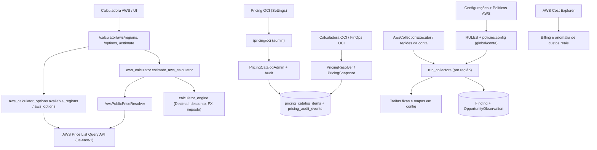
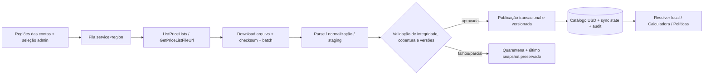

# Task 28.1 — AWS Pricing Architecture & Dependency Audit

**Data:** 2026-11-12  
**Base inspecionada:** `main` @ `969d8637ca8590c02ac368e7eaca79572530d411`  
**Classificação:** auditoria e especificação; **nenhuma alteração funcional**.  
**Legenda:** **[C]** comprovado por código; **[R]** decisão/recomendação de arquitetura; **[V]** depende de validação operacional, dados AWS ou homologação. Referências `path:Lx-Ly` correspondem ao commit acima e podem ser abertas em `https://github.com/DelucaSZ/finops-analytics/blob/969d8637ca8590c02ac368e7eaca79572530d411/<path>#Lx-Ly`.

## 1. Sumário executivo

1. **[C] A Calculadora AWS depende da AWS Price List Query API para descobrir regiões, opções e tarifas em tempo de requisição.** As rotas `GET /calculator/aws/regions` e `GET /calculator/aws/options` retornam HTTP 503 quando a API falha. O cálculo `POST /calculator/estimate` não depende de catálogo AWS persistido: resolve por `AwsPublicPriceResolver` externo. Evidências: `backend/app/api/routes/calculator.py:L19-L58`, `backend/app/services/aws_calculator_pricing.py:L37-L83,L114-L186`, `backend/app/services/aws_calculator_options.py:L23-L45,L49-L136`.
2. **[C] Há sete políticas AWS com dependência monetária estática ou mapa configurável**, sem `PricingResolver` regional: EBS órfão, IPv4 sem associação, snapshots, EC2 parada com EBS, EC2 não produtiva, LB sem tráfego e RDS não produtivo. Os coletores recebem a região real, mas não a usam para determinar tarifa. Evidências: `backend/app/services/policies.py:L22-L127`, `backend/app/services/collectors.py:L41-L45,L100-L105,L159-L168,L252-L297,L359-L409,L436-L518,L587-L657`.
3. **[C] Ausência de preço pode tornar-se zero nas políticas**, enquanto a Calculadora já preserva valor final nulo e estado de erro. Campos persistentes de `Finding` e `OpportunityObservation` são `NOT NULL`, com default zero: o contrato de oportunidades deve evoluir antes da migração. Evidências: `backend/app/services/collectors.py:L41-L45,L367-L407,L629-L656`, `backend/app/services/collector_types.py:L6-L24`, `backend/app/models/finding.py:L109-L115`, `backend/app/models/opportunity_observation.py:L40-L48`, `backend/app/services/calculator_engine.py:L229-L318`.
4. **[C] O catálogo persistente OCI já oferece Decimal, vigência, resolução fail-closed, controle administrativo e auditoria.** A identidade atual `(provider,service,sku,unit)` não traz dimensão regional nem metadados explícitos de produto AWS, modalidade e rate code. Evidências: `backend/app/models/pricing.py:L18-L59`, `backend/app/services/pricing_catalog.py:L25-L52,L136-L239`, `backend/app/services/pricing_admin.py:L135-L326`, `backend/app/models/pricing_audit.py:L13-L89`.
5. **[R] Adotar arquitetura híbrida: importar arquivos oficiais AWS Price List Bulk em lotes, persistir tarifas públicas USD versionadas, manter infraestrutura compartilhada de catálogo/auditoria com extensão AWS normalizada e resolver local regional para Calculadora + Políticas.** Nenhuma simulação depende de AWS em tempo real. O Billing/Cost Explorer continua fonte de gasto observado, independente de preços públicos.
6. **[V] Não há prova de que a mensagem de produção seja causada por IAM.** Código, captura da falha e forma de propagação estão confirmados; identidade IAM efetiva, credenciais, conectividade, DNS/proxy, erros AWS e logs da execução de produção não foram disponibilizados. Não foi feita consulta AWS ou inspeção do banco de produção.

## 2. Arquitetura atual, dependências e limites



**Mapa dos fluxos**:

| Consumidor | Fonte atual | Seleção de região | Persistência / finalidade | Migrar? |
|---|---|---|---|---|
| Calculadora EC2 e EBS | `AwsPublicPriceResolver.resolve` → `GetProducts(AmazonEC2)` | filtro `regionCode=request.region` | nenhuma tarifa AWS persistida; simulação pública | **Sim** |
| Calculadora RDS | `GetProducts(AmazonRDS)` | filtro `regionCode=request.region` | nenhuma tarifa AWS persistida | **Sim** |
| Dropdown de regiões | `GetAttributeValues(AmazonEC2,regionCode)` | lista externa, não regiões cadastradas | cache in-memory 1h; UI bloqueia sem opções | **Sim** |
| Dropdown de opções EC2/RDS | `GetProducts` | região selecionada | cache in-memory 1h | **Sim** |
| Sete políticas financeiras | `RULES.config` → `collectors.py` | recurso/scan regional, **tarifa não regional** | findings persistidos | **Sim** |
| Política de anomalia de crescimento | `Cost Explorer: UnblendedCost` | dimensão `REGION` de gasto realizado | custo observado e anomalia de histórico | **Não substituir** |
| Billing e RDS reservation coverage | Cost Explorer | escopo das contas/serviço/região, conforme consulta | gasto/cobertura observados | **Não substituir** |
| CloudWatch Cost Engine | `cloudwatch_pricing_rules`, tier/versionamento próprio | `region_scope` | custo analítico de telemetria, independente | **Inventariar; não migrar sem contrato específico** |
| Calculadora e oportunidades OCI | `PricingResolver` → `pricing_catalog_items` | identidade OCI atual, DB System possui binding regional separado | preço BRL e proveniência | **Preservar integralmente** |

Referências: `backend/app/services/aws_calculator.py:L91-L245,L249-L433`; `backend/app/services/collectors.py:L978-L1003`; `backend/app/services/collection_executors.py:L267-L295,L385-L456`; `backend/app/services/aws_billing.py:L316-L426`; `backend/app/services/aws_cost_explorer.py:L137-L191`; `backend/app/services/rds_cost_explorer.py:L30-L115`; `backend/app/services/cloudwatch_cost_engine.py:L195-L413`; `backend/app/services/oci_calculator.py:L204-L335`.

**Outros consumidores verificados:** `backend/app/services/oci_pricing.py` (catálogo OCI); `backend/app/services/rds_reservation_opportunities.py` (indicadores de cobertura/reserva, não lista pública de SKUs da Calculadora); `backend/app/services/opportunity_evidence.py` (consolidação e apresentação das evidências financeiras); `frontend/app/calculator/page.tsx` e `frontend/lib/calculator.ts` (contrato de opções, taxa de conversão e visualização). A contabilização histórica não deve recalcular preços quando uma tarifa pública mudar.

## 3. Inventário financeiro AWS e políticas — valores exatos existentes

| Política / função | Preço/fórmula atual **no código** | Região efetivamente aplicada à tarifa? | Efeito e risco |
|---|---|---|---|
| `ebs_unattached` / `_volume_monthly_cost` | `EBS_PRICES`: gp2 **0.10**, gp3 **0.08**, io1 **0.125**, io2 **0.125**, st1 **0.045**, sc1 **0.015** USD por GB-mês; tamanho × valor; tipo não encontrado cai em gp3 ou 0 | **Não** | ignora IOPS/throughput provisionados, região e distinções de produto |
| `ec2_stopped_with_ebs` / `_volume_monthly_cost` | mesmo mapa EBS, somado por volumes anexados; economia = custo mensal EBS | **Não** | 100% da despesa de EBS é apresentada como economia potencial; remoção do volume depende da ação recomendada |
| `eip_unassociated` / `collect_eip_unassociated` | **3.65 USD/mês por IPv4**, fallback idêntico no coletor | **Não** | taxa estática, sem versão nem horas observadas; diferente de gasto real |
| `snapshot_retention` / `collect_old_snapshots` | **0.05 USD/GB-mês**, `VolumeSize × 0.05` | **Não** | volume lógico é usado como **limite superior**, não bytes incrementais faturáveis; `confidence=low` |
| `ec2_nonprod_outside_hours` / `collect_nonprod_ec2_outside_hours` | `estimated_hourly_cost_by_instance_type={}`; desconhecido → **0**; custo = preço×**730h** e economia = preço×**365h** | **Não** | zero fictício, horas fora do expediente fixas em 50%; severidade fixa `medium` |
| `load_balancer_no_traffic` / `collect_load_balancers_no_traffic` | **16.43 USD/mês** igual para ALB, NLB e CLB; `confidence=low` | **Não** | ignora LCU/NLCU, processamento, outros itens e ausência de métricas |
| `rds_nonprod_idle` / `collect_idle_nonprod_rds` | `estimated_monthly_cost_by_instance_class={}`; desconhecido → **0**; `confidence` passa de medium para low | **Não** | ignora engine, Single-/Multi-AZ, licença, storage, região e horas; severidade fixa `medium` |
| `cost_growth_anomaly` / `collect_cost_growth_anomalies` | **Cost Explorer UnblendedCost** observado por serviço/região; baseline **28d**, janela **7d**, limite crescimento **30%**, delta **50 USD**, gasto **20 USD**; extrapolação mensal `current_spend/7×30`; economia **0** por semântica | **Sim, na origem de Billing** | **não migrar** para lista pública; zero de economia aqui significa “não estimada pela regra”, não SKU ausente |

**Referências:** `backend/app/services/policies.py:L22-L153`; `backend/app/services/collectors.py:L29-L45,L48-L144,L159-L228,L252-L337,L359-L411,L436-L584,L587-L659,L782-L959`. As entradas de `RULES` são defaults de política, **não** dados autoritativos AWS. Valores e mapas também podem ser sobrepostos em `Policy.config` persistido (`backend/app/services/policies.py:L158-L245`), logo a limpeza requer migração de configurações históricas, não só remover constantes do código.

**Severidade e confiança [C]:** `_severity` aplica limiares de economia USD **100=high**, **20=medium**, abaixo disso **low**, salvo regras que forçam severidade. Confiança é atribuída pelo coletor (p.ex. EIP high; snapshot/LB low; EBS medium; EC2 stopped medium/low; EC2/RDS nonprod medium se preço, senão low). A quantidade de amostras em CloudWatch e limiares operacionais determinam elegibilidade, mas **não validam a tarifa**. Ver `backend/app/services/collectors.py:L33-L39,L92-L95,L140-L142,L220-L226,L330-L335,L405-L409,L515-L517,L653-L657`.

**Filtros financeiros [C]:** `minimum_monthly_savings_usd` controla EBS órfão, EIP, snapshots e EC2 parada. Para EIP, teste da tarifa antes de iterar; para snapshots, usa limite superior; EC2/RDS não produtivos e LB não têm filtro mínimo monetário equivalente. Com preço ausente, não excluir silenciosamente findings operacionais: preservar elegibilidade e marcar estimativa monetária indisponível.

**Outros números calculados, não tabelas de tarifas:** `backend/app/services/aws_calculator.py:L23-L25,L142-L151,L211-L245,L303-L310,L340-L409` usa convenção **730h instância**, **720h storage**, mínimos **60s EC2/EBS** ou **600s RDS** e baseline gp3 **3.000 IOPS/125 MBps** ou **12.000/500** conforme regra específica; estes são parâmetros de medição/limitação, não preços fixos. `backend/app/services/calculator_foundation.py:L190-L233` aplica desconto/FX/imposto, não fornece tabela de preços. `backend/app/services/cloudwatch_pricing.py` e `backend/app/models/cloudwatch_pricing.py` possuem regra tarifária **independente com escopo e tiers**; avaliar convergência futuramente sem alterar nesta fase.

## 4. Diagnóstico do erro AWS Pricing API

**Cadeia comprovada [C]**:

`frontend/app/calculator/page.tsx:L117-L135` solicita `fetchAwsRegions` (`frontend/lib/calculator.ts:L144-L150`) → `/calculator/aws/regions` (`backend/app/api/routes/calculator.py:L29-L36`) → `available_regions` → `_regions_hour` → `_client().get_attribute_values(ServiceCode=AmazonEC2, AttributeName=regionCode)` (`backend/app/services/aws_calculator_options.py:L23-L45`). Qualquer exceção é convertida em `AwsPriceUnavailable("aws_pricing_regions_unavailable")`, exposta como **503**, sem detalhe técnico da causa no contrato HTTP.

**Mecanismo observado no código [C]:**

| Aspecto | Implementação atual | Consequência |
|---|---|---|
| Endpoint da API | `boto3.client("pricing", region_name="us-east-1")` | **correto conceitualmente**: endpoint não é região do recurso; região de produto usa `regionCode` |
| Identidade | default credential chain do **backend** | IAM é da instância/role do backend, não da role de onboarding do cliente usada em coletores |
| `GetAttributeValues` | máximo 100 resultados, até **4 páginas**, cache LRU de **2 buckets/hora** | truncamento falha fechado; exceções não individualizadas |
| `GetProducts` | `TERM_MATCH` ou `CONTAINS`, máximo 100, até **12 páginas** | escopo amplo pode exceder limite; erro `aws_pricing_result_exceeds_page_limit` |
| Timeouts/retries | `connect_timeout=3`, `read_timeout=7`, `max_attempts=2` | vulnerável a variância de rede/limite sem retry dedicado por status |
| Cache | LRU process-local, chave `(service,filters,hour_bucket)`, até **256** | não é catálogo nem cache durável; reinício/processos diferentes não compartilham dados |
| Validação de preço | apenas `OnDemand`; unidade exata; range `0..Inf`; USD Decimal não negativo; `effectiveDate <= at` | tiers, preços de outras modalidades e datas históricas não são plenamente suportados |
| Ambiguidade | aceita **exatamente um** rate candidate; caso contrário `pricing_configuration_error` | decisão segura, mas não informa quais atributos faltaram |
| Falta de SKU | `sku_missing`; erro remoto → `pricing_configuration_error` | a Calculadora evita zero fictício, mas a UI perde descoberta de opções |
| Referência histórica | rejeita `at` futuro; usa snapshot retornado pela API atual para data passada | **não** garante reprodução de preço histórico real; precisa de versões locais |

Referências: `backend/app/services/aws_calculator_pricing.py:L24-L83,L85-L186`; `backend/app/services/aws_calculator_options.py:L23-L45,L49-L136`; `backend/app/services/aws_calculator.py:L415-L433`; `backend/app/api/routes/calculator.py:L19-L58`.

**Causas candidatas [V], em ordem de verificação, não de certeza:** ausência de `pricing:GetAttributeValues` na role efetiva do backend; ausência/expiração de credenciais; falta de egress HTTPS/DNS para endpoint Pricing; falhas temporárias, timeout, throttling; paginação excedida. A captura de tela é compatível com qualquer falha dessa cadeia. `pricing:GetProducts` e `pricing:GetAttributeValues` precisam ser confirmadas na identidade do backend; futura importação Bulk exige verificar `pricing:ListPriceLists`, `pricing:GetPriceListFileUrl` e, se usado, `pricing:DescribeServices`. Não conceder permissões sem revisão, não usar credenciais de contas clientes no sincronizador. **[V]** Validar na produção com logs sanitized (`botocore ClientError.code`, endpoint, elapsed, request-id se presente), identidade STS, políticas IAM, conectividade e teste somente leitura; nenhuma validação operacional foi executada aqui.

**Comparação de estratégia:**

| Estratégia | Benefícios | Limitações | Decisão |
|---|---|---|---|
| A. Query API direta | filtros granulares, API existente, volume sob demanda | impede simulação offline; timeout, IAM, throttling, páginas, ambiguidade | **Rejeitar no caminho de leitura** |
| B. Bulk API | arquivos oficiais USD por serviço/região, throughput em lote, versão do arquivo | parsing/volume/armazenamento, validação de layout/tiers, controle de publicação | **Origem primária de ingestão** |
| C. Híbrida: Bulk + catálogo + resolver local | disponibilidade, auditoria, vigência, uma fonte para Políticas/Calculadora, mudanças controladas | exige esquema, worker, observabilidade, migração gradual | **Recomendada** |

**Base externa:** documentação AWS [Bulk](https://docs.aws.amazon.com/awsaccountbilling/latest/aboutv2/using-the-aws-price-list-bulk-api.html), [Query](https://docs.aws.amazon.com/awsaccountbilling/latest/aboutv2/using-price-list-query-api.html), [tipos de tarifa, tiers e limites](https://docs.aws.amazon.com/awsaccountbilling/latest/aboutv2/finding-prices-in-service-price-list-files.html), [notificações](https://docs.aws.amazon.com/awsaccountbilling/latest/aboutv2/notifications-price-list-api.html). `ListPriceLists` permite `ServiceCode`, `CurrencyCode`, `RegionCode` e `EffectiveDate` e `GetPriceListFileUrl` devolve URL de arquivo JSON/CSV. O preço público tem caráter informativo e não representa descontos/contratos particulares.

## 5. Catálogo existente, alternativas e decisão de modelagem

**Estado atual [C]:** `pricing_catalog_items` possui `provider, service, sku, description, unit, price NUMERIC(20,8), currency, effective_from, effective_until, enabled, source`, `id` UUID-string e timestamps. Unique `(provider,service,sku,unit,effective_from)` e índice de lookup no mesmo conjunto + `enabled`. `PricingResolver` e `PricingSnapshot` selecionam intervalos `[effective_from,effective_until)`, detectam múltiplas linhas efetivas e moeda divergente. Administração oferece lock por chave no PostgreSQL e verificação de overlap; auditoria é append-only com `before_data/after_data`, ator, motivo e ações. A API `/pricing/oci` **exige admin para leitura** e `require_recent_admin` para alterações. `pricing_audit.py` ainda monta rótulo de auditoria hardcoded `OCI`, a ser parametrizado ao reutilizar. Evidências: `backend/app/models/pricing.py`; `backend/app/services/pricing_catalog.py`; `backend/app/services/pricing_admin.py:L41-L326`; `backend/app/services/pricing_audit.py:L42-L159`; `backend/app/api/routes/pricing.py:L21-L163`; migrations `0024_pricing_catalog.py` e `0025_pricing_audit.py`.

| Alternativa | Integridade/região | Retrocompatibilidade | Operação |
|---|---|---|---|
| A. Apenas adicionar `region`/JSON ao catálogo | simples, mas mistura a identidade do produto, rate code e atributos em uma linha | altera unique e resolver, risco OCI | consultas JSON e catálogo pouco normalizado |
| B. Tabelas AWS isoladas | excelente especificidade | sem alteração OCI | duplica lógica, auditoria, API e fontes |
| **C. Núcleo compartilhado + extensão AWS normalizada** | **região explícita + produto distinto de tarifa, FKs e índices** | **OCI mantém contrato e rows** | **reuso da administração/auditoria, lookup regional tipado** |

**[R] Escolha C** com `pricing_catalog_items` como **fonte autoritativa dos preços**, expansão mínima de dimensão regional e extensão AWS de metadados, sem segunda cópia de preço.

### 5.1 Entidades propostas (especificação, não migration)

1. `pricing_catalog_items` **existente e preservada:** adicionar `region_code VARCHAR(40) NULL`; para OCI `NULL` continua significando “sem dimensão regional nesse catálogo”. Para AWS, `region_code NOT NULL` por CHECK condicionado a `provider='aws'`. Campos existentes `sku`, `unit`, `price NUMERIC(20,8)`, `currency='USD'`, `effective_from`, `effective_until`, `enabled`, `source` continuam sendo **tarifa/versionamento**. No AWS, `sku` será identidade técnica estável de tarifa, por exemplo `<product_sku>:<rate_code>` **validada contra o limite de 160 caracteres**; se algum valor exceder, migrar campo para tamanho adequado antes de inserir, não truncar. Não depender de nome comercial. `rate_code` exato permanece na extensão.
2. `aws_pricing_products`: `id UUID`, `service_code` (p.ex. AmazonEC2), `region_code`, `product_sku` oficial, `product_family`, `description`, `product_attributes JSONB` tipado/allowlisted, `created_at`, `updated_at`; unique `(service_code,region_code,product_sku)`. SKU oficial **não** é rate code.
3. `aws_pricing_rate_details`: `pricing_item_id` FK UNIQUE NOT NULL → `pricing_catalog_items.id` (delete RESTRICT), `product_id` FK → `aws_pricing_products.id`, `rate_code` oficial, `term_code`, `purchase_option` (`on_demand` inicialmente), `billing_unit_aws`, `begin_range`, `end_range`, `price_dimension_description`, `import_batch_id` FK, `source_effective_at`, `sync_timestamp`, `source_hash`, `pricing_status` (`active|unsupported|quarantined|withdrawn`). Tarifas não lineares/tiered entram como **unsupported** até terem contrato explícito; não podem ser consumidas pelo resolver linear.
4. `aws_pricing_import_batches`: `id`, `service_code`, `region_code`, `currency='USD'`, `source_file_url/price_list_arn` (sem segredos), `source_publication_version`, `etag/checksum`, `started_at`, `finished_at`, `sync_timestamp`, `status` (`running|staged|validated|published|partial|failed`), contagens `seen/valid/unsupported/rejected`, diagnóstico sanitizado e `requested_by`/tipo de execução. Único por `(service_code,region_code,source_publication_version,checksum)` quando aplicável.
5. `aws_pricing_sync_state`: `service_code,region_code` UNIQUE, `last_successful_batch_id`, `last_attempt_at`, `last_success_at`, `next_due_at`, `coverage_status`, contagens por família, erros parciais, revisão do esquema. “Não sincronizado”, “parcial”, “desatualizado” e “erro” são estados distintos da existência de preços.
6. Auditoria compartilhada: continuar `pricing_audit_events`/serviço de auditoria para versões de `pricing_catalog_items`, acrescentar `region_code`, `import_batch_id` nos detalhes de proveniência e **identidade regional** nas consultas de histórico. O evento `IMPORTED` já existe no enum, mas fluxo automático de registro deve ser implementado; não supor que já é utilizado pela importação AWS.

**Índices/constraints [R]:** substituição transacional, por migration futura, da UNIQUE antiga que impediria o mesmo SKU/tarifa na mesma vigência em regiões diferentes: índice **parcial OCI** `UNIQUE(provider,service,sku,unit,effective_from) WHERE provider<>'aws'` e índice **parcial AWS** `UNIQUE(provider,service,region_code,sku,unit,effective_from) WHERE provider='aws'`; índice B-tree de lookup `(provider,service,region_code,sku,unit,enabled,effective_from DESC)`; índice `(service_code,region_code,product_sku)` nos produtos, `(product_id,rate_code,purchase_option)` e `(import_batch_id)` na extensão. CHECK `region_code` obrigatório para AWS, ausente para OCI; CHECK `currency=USD` para AWS; intervalo temporal válido e preço >= 0. Para overlaps **em intervalos efetivos**, usar chave/lock e constraint temporal PostgreSQL (exclusion com `tstzrange` e GiST/btree_gist quando viável), ou validação SERIALIZABLE + testes concorrentes. Unique por `effective_from` sozinha **não** impede vigências sobrepostas.

**Importante [R]:** `PricingIdentity`/resolver OCI existentes devem manter assinatura e resultado; criar `AwsRegionalPricingResolver` especializado que faz JOIN entre catálogo e extensão, sempre qualificando região. `PricingSnapshot` do OCI não deve receber AWS com risco de colisão: snapshot AWS é escopado por região+data, ou por conjunto explícito de regiões com chave composta. Validar custo de consulta/index e tamanho de lote com volume real dos arquivos. Política de retenção: manter versões financeiras usadas em evidências mesmo após preço expirar; não sobrescrever `price` no mesmo row.

**Migração [R]:** migration aditiva e backfill controlado de `region_code=NULL` para todas as rows OCI atuais; reconstruir constraints/índices **sem alterar preços OCI**; migrar read-only OCI regressivo; importar e validar AWS em staging; ligar leitura por flag somente com cobertura suficiente; não transformar defaults históricos `policies.config` em tarifas. Remover campos financeiros legados da edição de políticas por migração de schema/UI, com tratamento de overrides persistidos e trilha de auditoria. Nada disso foi implementado na Task 28.1.

## 6. Cobertura necessária, seleção de SKU e componentes

| Serviço | Origem/família candidata | Chaves exatas exigidas | Unidade e componentes separados |
|---|---|---|---|
| EC2 Linux/Windows Shared On-Demand | `AmazonEC2` / `Compute Instance` | `regionCode, instanceType, operatingSystem, tenancy=Shared, preInstalledSw=NA, capacitystatus=Used, operation`, purchase option | `Hrs`; tarifa Windows já inclui o OS no SKU escolhido; instância **não inclui EBS/IPv4/tráfego** |
| EBS gp2/gp3/io1/io2/st1/sc1 | `AmazonEC2` / famílias storage/performance | `regionCode, volumeApiName, usagetype` e discriminação de dimensão/operation | `GB-Mo`; IOPS e throughput provisionados separados; gp3 inclui baseline conforme contrato; io1/io2 adicionais a homologar |
| RDS PostgreSQL/MySQL/MariaDB | `AmazonRDS` / `Database Instance` | `regionCode, instanceType, databaseEngine, deploymentOption=Single-AZ|Multi-AZ, deploymentModel, licenseModel, edition/operation` | `Hrs`; storage, IOPS, throughput, backups/snapshots e transferência não estão automaticamente incluídos |
| RDS storage | `AmazonRDS` / `Database Storage` | `regionCode, usagetype, engine quando aplicável, deploymentOption, storage_type` | `GB-Mo`, mais performance e outros adicionais conforme SKU |
| EBS snapshots | tarifa de snapshots EBS no arquivo oficial, validar família/uso real | região, tier, tipo de snapshot e volume **efetivamente faturável** | `GB-Mo`; tamanho lógico informado por `describe_snapshots` não prova bytes incrementais |
| IPv4 público | tarifa pública `AmazonVPC`/família a determinar pelo produto oficial | região, tipo de uso, charge dimension, IP-hour; não assumir identidade do EIP antigo | tipicamente `Hrs`; diferenciar uso alocado de uso faturado; validar SKU oficial |
| ALB / NLB / CLB | arquivo oficial `AWSELB`/serviço aplicável | região, `load_balancer_type`, operação, modalidade | `Hrs` **e** LCU/NLCU/uso por dimensões; dados CloudWatch para componentes variáveis |
| Outros (CloudWatch, reservas) | regras próprias/Cost Explorer | preservar semântica de cada módulo | fora do corte inicial de unificação |

**[C] Limites atuais da Calculadora:** EC2 suporta Linux/Windows Shared On-Demand, EBS principal gp2/gp3, gp3 performance adicional; RDS engines OSS, Single-/Multi-AZ, gp2/gp3 de storage, mas **não** precifica performance RDS extra. Código: `backend/app/services/aws_calculator.py:L91-L245,L249-L412`. **[R]** Ingestão pode armazenar SKU de seis famílias EBS, mas UI e fórmulas só devem habilitar novo tipo quando métrica e contrato de consumo estiverem completos. Não estimar custo total de LB, snapshots, RDS com componentes desconhecidos; devolver custo parcial/indisponível e explicar componentes fora do escopo.

**[V]** Não fixar `productFamily`, `usagetype`, `operation` e service code de IPv4/LB/snapshot apenas por hipótese: validar contra **arquivos oficiais reais de pelo menos duas regiões** antes de habilitar mapeamento. Não foram baixados SKUs nem confirmada cobertura de tarifas em produção nesta auditoria.

## 7. Resolver AWS regional e contratos

**[R] Contrato interno proposto (conceitual):**

```python
resolve_aws_price(
    *,
    service: Literal["ec2", "ebs", "rds", "ipv4", "snapshot", "alb", "nlb", "clb"],
    region_code: str,
    configuration: Mapping[str, str],  # seleção exata de atributos
    billing_unit: str,
    reference_at: datetime,
    purchase_option: str = "on_demand",
) -> AwsRegionalPriceResolution
# result: status, unit_price: Decimal|None, currency="USD",
# catalog_item_id, product_sku, rate_code, billing_unit,
# effective_from/until, import_batch_id, synced_at, source,
# matched_attributes, warning_code
```

**Regras obrigatórias:** somente SELECT no PostgreSQL; região e identidade do produto **sempre obrigatórias**; atributos canônicos por serviço; versão cuja vigência inclui `reference_at`; apenas `enabled` e status publicável; **correspondência exata**, sem fallback para SKU similar, região vizinha ou produto de outra modalidade; preço Decimal USD; `priced` pode ter **0 real e documentado**, distinto de `sku_missing`; mais de uma tarifa candidata é `pricing_configuration_error`, jamais escolha arbitrária; dado futuro/expirado `price_not_effective`; ausência/falha de sincronização `sync_required`; cobertura parcial gera `partially_priced` no agregado da Calculadora. Reusar tipos/status de `backend/app/schemas/calculator.py:L203-L278` com **extensão compatível** para `sync_required` (schema e `frontend/lib/calculator.ts:L7-L10`) e retornar proveniência por componente, não apenas por soma.

**Exemplo lógico, sem números inventados:** `resolve_aws_price(ec2, sa-east-1, {instanceType:m6i.large, operatingSystem:Linux,tenancy:Shared,...}, INSTANCE_HOUR, 2026-11-12)` seleciona linha desta região, SKU/rate code e versão; `us-east-1` não é fallback. Mesmo recurso em outra região resolve outra tarifa ou ausência explícita.

**Calculadora:** adaptar `aws_calculator.py` para injetar resolver local e sessão; preservar contrato de medição `calculator_engine.py`, cálculo de desconto seletivo, FX manual e imposto. Preços armazenados são **públicos USD**. O desconto da Calculadora não é um dado do catálogo. Não aplicar descontos, FX ou imposto automaticamente em políticas. Para `pricing_reference_date` passado, só aceitar preço se existir versão local historicamente compatível; não usar tarifa atual como suposta histórica.

**Políticas:** `run_collectors` hoje recebe `session,regions,policies` e as funções recebem `(session,region,config)` (`collectors.py:L978-L1003`). Adaptar no futuro com contexto `AwsPricingContext(db resolver,reference_at,region)` por **recurso**, não salvar mapa por região em `Policy.config`. A região da coleta é um ponto de partida, mas resource ARN/metadata deve ser conferido, especialmente regras globais. Capturar uma versão consistente para o ciclo e persistir `pricing_reference_at`, `catalog_item_id`, `product_sku`, `rate_code`, `region`, `quantity`, `unit_price`, `currency`, `source`, `batch`, vigência e componentes por finding.

**Achados sem preços [R]:** exigir evolução atômica de `CollectedFinding.current_monthly_cost`, `estimated_monthly_savings`, `Finding` e `OpportunityObservation` (atuais `NOT NULL`), schemas, filtros/ordenação, somatórios/dashboard e histórico para `Decimal | None` com `pricing_status` explícito. Preservar finding operacional com valor monetário **desconhecido**, não zero. `minimum_monthly_savings_usd` não pode eliminar recurso cujo custo é desconhecido; aplicar limiar apenas quando cotação completa e registrar `threshold_not_evaluable` caso contrário. Severidade operacional poderá ser calculada separadamente; o status financeiro fica inequívoco. Onde métrica de volume incremental/LCU for desconhecida, usar `partial` ou `unknown` conforme contrato, nunca projetar total fictício. **Não alterar achados históricos** ao entrar nova tabela; snapshots da época permanecem persistidos.

## 8. Sincronização, cobertura regional e publicação segura

**Descoberta [C]:** `AwsAccount.regions` é lista JSON com default `["sa-east-1"]` (`backend/app/models/account.py:L62-L94`); `AwsCollectionExecutor.prepare/execute` utiliza essas regiões (`backend/app/services/collection_executors.py:L267-L295`); `run_collectors` itera cada política×região (`backend/app/services/collectors.py:L978-L1003`). Esse é o ponto inicial para descobrir regiões **utilizadas/configuradas**. Não inferir que cobre toda a AWS nem limitar artificialmente a apenas essas regiões.

**[R] Pipeline proposto:**



1. Enumerar `service×region` das contas AWS habilitadas, mais regiões selecionadas pelo administrador; guardar marca de necessidade de sincronização. Aceitar inclusão manual de novas regiões desde que a AWS as publique; ausência no catálogo nunca provoca fallback. Excluir regiões especiais incompatíveis do escopo comercial só mediante regra explícita.
2. Importação inicial controlada por lote, arquivo JSON/CSV oficial, com paginação das APIs de listagem, streaming em staging, compressão quando aplicável, limites de tamanho, checksum, contagem de objetos e **rate dimensions**, qualidade dos atributos e USD obrigatório. Guardar URL de origem e identificador publicado; não gravar segredos no log/banco.
3. Identidade idempotente por `service,region,source_version,checksum`; retentativa com checkpoints; lotes independentes e locks por `service×region`; publicação em transação com `last_successful_batch_id`, eventos de auditoria e invalidation do cache após commit. Arquivo incompleto/ambíguo fica em quarentena.
4. Validar cobertura **por família+região+componente** (EC2, EBS storage/IOPS/throughput, RDS instance/storage, IPv4, snapshots, ALB/NLB/CLB). Nunca concluir “sincronizado” só pelo download ter sido concluído. Declarar `partial` se faltarem SKUs necessários e conservar último snapshot publicado. Tarifa de novos produtos não pode ativar regra ainda não homologada.
5. Agendar atualização periódica (cadência inicial diária [R] sujeita a SLA) e manual autorizada. Considerar notificação oficial de atualização por SNS como gatilho adicional, não única origem. Logs estruturados com duration, importados/ignorados, coverage, error code, stale age; alertas por serviço/região. UI deve mostrar `synced`, `partial`, `stale`, `never_synced`, `failed` e data do **último sucesso**, distinguindo erro da tentativa recente de inexistência total de preços.
6. Sem expiração destrutiva quando falhar: não apagar/desativar preço publicado por arquivo incompleto; quando edição da AWS for detectada e validada, fechar vigência anterior na data efetiva aprovada e criar nova versão. Não reescrever histórico; alterações de fonte com data efetiva retroativa exigem política de reconciliação/homologação explícita.
7. As regras de preço usam o período `[effective_from,effective_until)`. `source_effective_at`, `source_publication_version` e `synced_at` são campos **diferentes**. Se arquivo só fornecer snapshot presente, não inventar histórico anterior à cobertura. Distinguir freshness do lote da vigência dos itens.

**Segurança [R]:** consultas de catálogo de usuários autenticados conforme autorização do módulo; administração financeira e sync manual a administradores, com confirmação/autorização reforçada quando aplicável (`require_recent_admin` existente no OCI). Audit de usuário/SYSTEM e motivo obrigatório para override/edição manual, incluindo antes/depois e região. Permissões IAM do sync separadas das roles de clientes e da permissão de publicar no PostgreSQL. Dados públicos/contratuais em estruturas e fontes separadas; jamais gravar desconto negociado na tarifa pública.

## 9. Riscos, pré-requisitos e limitações

| Risco | Classe / impacto | Contenção antes de liberar |
|---|---|---|
| Zero fictício nos findings por fallback de mapa ausente | **Financeiro crítico** | campos/contratos nullable + status, regressão de dashboard e oportunidade |
| Vigência duplicada, SKU/RATE ambíguo ou cross-region | **Financeiro crítico** | índice/overlap concorrente, resolver exato, fail-closed, testes multi-region |
| EBS io1/io2, RDS performance, LB LCU e snapshot incremental | **Financeiro alto** | componentes independentes, cobertura por componente, `unknown/partial`, métricas extras |
| Preço público confundido com gasto faturado/desconto contratual | **Financeiro alto** | sem alterar Billing/CE; tax/FX apenas na Calculadora; UI de proveniência |
| Mudança de contrato `Finding`/agregações | **Compatibilidade alto** | migração aditiva, feature flag, dual read, snapshot histórico intacto |
| Alterar UNIQUE atual de OCI | **Compatibilidade alto** | migração transacional e testes catalog/admin/audit OCI, inclusive concorrência |
| Falha/arquivo parcial apagando tarifas válidas | **Operacional alto** | staging, publish atômico, last-good, rollback e monitoramento |
| Cobertura inicial incompleta/região nova | **Operacional médio/alto** | seleção por regiões ativas+admin, sync state e status explícito |
| 8 casas decimais insuficientes em alguns componentes AWS | **Financeiro médio** | testar smallest nonzero rate oficial; ampliar NUMERIC se necessário sem float |
| Cobertura legal do price list (Free Tier, promoções, contrato) | **Financeiro médio** | declarar público informativo e exclusões; não afirmar equivalência invoice |
| Permissão/rede do backend para importação | **Operacional alto [V]** | check IAM/egress/STS e observabilidade antes de habilitar sync |
| Legacy overrides de campos financeiros das políticas | **Compatibilidade alto** | migração e testes de herança global/conta; UI não mostrar tarifa editável em política |
| Falta de histórico pré-importação | **Técnico médio** | retornar `price_not_effective`, não extrapolar tabela atual para passado |

**Pendências de homologação [V]:** erro AWS real na produção; volume de SKUs e cardinalidade por serviço/região; nomenclatura exata de famílias e unidades para IPv4/LB/snapshots; taxas de tier e minimum; tolerância a registros gratuitos; cobertura real de regiões nas contas, incluindo regiões com recursos mas não configuradas; escalabilidade de NUMERIC(20,8); efeitos de nullable em dashboards e histórico; versão do PostgreSQL para constraint temporal; eventuais permissões IAM da role do backend. **Nenhum SKU/preço de produção foi presumido nesta task.**

## 10. Plano das Tasks 28.2–28.9

| Task | Escopo exato | Depende / critério de saída |
|---|---|---|
| **28.2 — Modelo e migrações** | dimensão regional, tabelas AWS produto/tarifa/batch/status, constraints, índices, extensões auditadas; contratos nullable de opportunities planejados e implementados **antes do switch** | 28.1; OCI intacta, migration + rollback seguros, testes de region/overlap |
| **28.3 — Importação oficial e sync** | Bulk importer, allowlists de service/region, parsing de SKU/rate, staging, checksum, idempotência, publicação transacional, scheduler/admin manual e métricas | 28.2; dados reais em ambiente não produtivo, last-good garantido |
| **28.4 — Resolver regional e cobertura** | `AwsRegionalPricingResolver`, modelo status/proveniência/snapshot, consultas batch, matching exato e testes cross-region | 28.2+28.3; sem network em `resolve`; comportamento de missing testado |
| **28.5 — API AWS Pricing e governança** | `/pricing/aws` read/admin/history/audit/status/sync, permissões, justificativas, endpoints de regiões/opções vindos do catálogo | 28.3+28.4; auth e contratos PT-BR/EN-US auditados |
| **28.6 — UI Pricing AWS em Settings** | aba própria com filtro por região/serviço/status, versões, origem, auditoria, cobertura, sync manual e erros; Design System e i18n | 28.5; OCI e layout preservados |
| **28.7 — Calculadora AWS local** | substituir descoberta e `GetProducts` de requests por leitura local, preservar EC2/RDS/EBS, descontos, FX/impostos, status parcial, fonte e regiões selecionáveis | 28.4+28.5; simulação offline, paridade nas regiões homologadas |
| **28.8 — Políticas AWS dinâmicas** | remover mapas/tarifas de `RULES.config`, resolver preço por recurso/região, migrar overrides antigos, evidência por componente, nullable e severidade não enganosa | 28.2+28.4+28.7; 7 regras com cobertura e faltas tratadas sem zero |
| **28.9 — QA integrada e rollout** | testes backend/front E2E, migração OCI, comparação entre regiões, prova de ausência de rede na consulta, reconciliação Billing, observabilidade, documentação e rollout controlado | todas; relatório de cobertura, feature flags/rollback, sem regressões |

**Sequência de ativação [R]:** schema e sincronizador em modo sombra → comparação do resolver com SKUs oficiais → UI/read API → Calculadora sob flag → suporte de findings nullable e migração de policies config → Políticas sob flag → QA/rollout. Se o catálogo não cobre regiões relevantes, o sistema retorna missing/unknown e **não** habilita cálculo definitivo. Evitar tarefas dependerem de importação automática em produção sem aprovação operacional.

## 11. Matriz de validação para 28.2–28.9

| ID | Cenário | Resultado obrigatório |
|---|---|---|
| V01 | SKU/tipo EC2 idêntico em `sa-east-1` e `us-east-1` com tarifas distintas **fixture** | cada resolução consulta região exata e mantém preços distintos |
| V02 | produto de região ausente, mesmo SKU em região próxima | `sku_missing` ou `sync_required`; sem fallback |
| V03 | mesmo nome comercial com SKU/term/rate diferentes | match de atributos completo; zero seleção heurística |
| V04 | duas versões vigentes ou intervalos sobrepostos | publicação rejeitada e consulta fail-closed como ambígua |
| V05 | preço verdadeiro `0.00000000` e SKU inexistente | primeiro `priced`; segundo missing com `None` |
| V06 | rate fora da vigência / timestamp histórico sem versão | `price_not_effective`, sem uso retroativo do preço atual |
| V07 | EBS gp2/gp3/io1/io2/st1/sc1 e perf IOPS/MBps | cada componente correto ou `unsupported/unknown`, nunca custo parcial tratado como total |
| V08 | EC2 Linux vs Windows Shared, 730h e mínimos por duração | SKU, desconto elegível e convenção de cobrança preservados |
| V09 | RDS PostgreSQL/MySQL/MariaDB Single/Multi AZ, storage e desempenho | dimensões distintas, não mistura de deployment/engine; adicional não conhecido → parcial |
| V10 | snapshots incrementais sem métrica faturável | custo indisponível/limite explicitamente não definitivo |
| V11 | IPv4 desassociado; LB ALB/NLB/Classic com uso ausente | horas/base separadas de variáveis; desconhecido não vira USD 0 |
| V12 | sete políticas em contas com regiões diferentes e overrides legados | custo por região real, configurações operacionais herdadas, campos financeiros removidos da edição |
| V13 | `minimum_monthly_savings` e preço desconhecido | não descartar oportunidade operacional; flag `threshold_not_evaluable` |
| V14 | ciclo histórico de finding já salvo, atualização de tarifa no catálogo | custo e evidência anteriores não se alteram |
| V15 | importação interrompida/arquivo truncado/duplicado/replay | rollback ou quarantined, last-good intacto, idempotência |
| V16 | importação de novo serviço/região e região removida do escopo de conta | status claro, novas opções só com cobertura; histórico preservado |
| V17 | pedido de Calculadora com egress AWS bloqueado, DB disponível | estimativa local normal, sem chamada boto3 à AWS |
| V18 | auditoria CRUD/sync: usuário comum, admin, admin recente | permissões conforme contrato, motivo e evento, sem edição silenciosa |
| V19 | Billing/CE e anomalia Cost Explorer antes/depois | valores observados inalterados, sem descontos/FX/impostos da Calculadora |
| V20 | OCI Pricing: CRUD, versionamento, snapshots, Windows/DB e Calculadora | nenhuma regressão nas identidades, BRL, histórico e regras atuais |
| V21 | dados AWS com unidade/currency inadequada, tiers, fração de centavo | rejeição/quarentena, precisão Decimal, sem arredondamento precoce |
| V22 | testes em PT-BR/EN-US, tabela responsive, estados missing/partial | status e proveniência legíveis e acessíveis em ambos idiomas |
| V23 | concorrência: dois imports e admin override da mesma chave | uma versão publicável sem overlap, auditoria completa |
| V24 | verificar a causa do 503 em produção | logs IAM/egress/ClientError identificam causa; independência da Calculadora comprovada após rollout |

**Testes existentes para reaproveitar:** `backend/app/tests/test_aws_calculator.py` (região, desconto e ausência de preço); `test_calculator_engine.py`, `test_calculator_foundation.py`, `test_collectors.py`, `test_pricing_catalog.py`, `test_pricing_admin.py`, `test_pricing_audit.py`, `test_pricing_catalog_migration.py`, `test_pricing_provenance.py`, `test_oci_calculator.py`, `test_oci_pricing.py`, `test_aws_billing.py`; `frontend/tests/aven-calculator.test.mjs`, `aven-calculator-localization.test.mjs` e `pricing-page.test.mjs`. `test_aws_calculator.py:L247-L255,L336-L358` já valida ausência de fallback regional/total nulo; adicionar testes para o novo catálogo e ciclo de sincronização em vez de remover a proteção.

## 12. Validação desta task e decisões finais

**Comprovado em leitura de código:** fluxos de Calculadora/Políticas/OCI/Billing, valores hardcoded identificados, fontes de custo real separadas, contratos de versões/auditoria existentes, dependência externa e caminho de erro 503, campos monetários não-null dos findings e escopo regional configurado por conta. Foram inspecionados os arquivos de implementação, modelos, schemas, migrations, UI e testes citados; **não foi executada suíte de testes de produto**, pois esta entrega é somente documental.

**Decisões recomendadas:** manter tarifas públicas USD somente no Pricing AWS, armazenamento PostgreSQL compartilhado com dimensão regional explícita e metadados normalizados de SKU/rate, Bulk API como ingestão primária, resolver local fail-closed, mesmo resolver na Calculadora e políticas, proveniência imutável, controles de governança OCI reaproveitados, custos reais de Billing preservados.

**Sem homologação:** causa raiz do erro da produção, nomes de SKUs e rate codes por todos serviços/territórios, completude do inventário financeiro externo à árvore de código, volumes importáveis reais, custo operacional do parser, resultado de deploy/migration e qualquer alteração de runtime. Não afirmar que esses pontos foram verificados.

**Conclusão:** a Task 28.2 pode começar pela modelagem acima sem reinvestigar a arquitetura. Antes de ativar pricing real em políticas, deve resolver explicitamente o contrato `unknown ≠ 0`, cobertura regional, fonte e vigência — os três maiores riscos para confiabilidade financeira.
