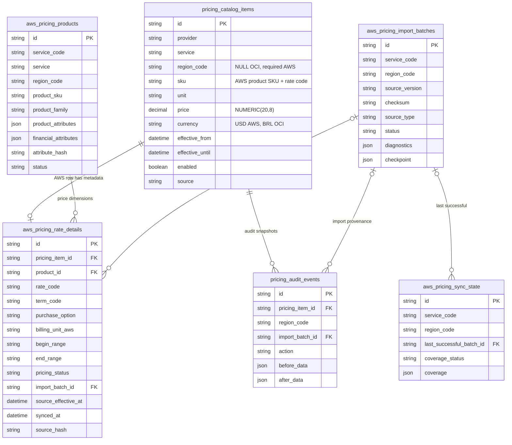

# Task 28.2 — AWS Regional Pricing Database Foundation

**Base:** 28.1-architecture-audit.md (arquitetura **C — núcleo compartilhado e extensão AWS normalizada**).  
**Escopo:** fundação de dados e API Python **interna**; sem importação, sync, endpoints, mudança de calculadora/políticas ou deploy.

## 1. Arquitetura efetivamente adotada

O preço unitário vive **exclusivamente** em `pricing_catalog_items`, inclusive para AWS. A identificação do produto oficial, o rate code e a proveniência AWS ficam em tabelas relacionadas, não em uma segunda tabela monetária. A coluna `region_code` é obrigatória para `provider='aws'`; registros OCI continuam com `NULL`, mesma chave e preços BRL. A nova resolução AWS não utiliza `PricingResolver` genérico nem `PricingSnapshot` de OCI.



### Identidade do produto

`(service_code, region_code, product_sku)` é UNIQUE. `service` é a classificação Aven (ec2, rds, ebs, snapshot, ipv4, alb/nlb/clb). `product_attributes` preserva o payload técnico; `financial_attributes` contém somente atributos financeiros explicitamente aceitos e normalizados. O SHA-256 da serialização canônica destes últimos é indexado junto de serviço/região. O hash é um *pré-filtro*, e o resolver confirma igualdade completa das chaves/valores após o SELECT. Produto com mesmo SKU e atributos financeiros alterados é conflito, não overwrite. A lista de campos é extensível em código sem alterações de esquema.

**Não** se assume que o mesmo `instanceType` ou nome comercial seja um SKU único. Matching incompleto, SKU contraditório e múltiplas ofertas compatíveis resultam em ausência explícita ou ambiguidade, jamais tarifa selecionada por heurística.

### Identidade da tarifa

A chave AWS no núcleo monetário é `(provider='aws', service, region_code, sku=product_sku:rate_code, unit, effective_from)`, além do `pricing_item_id` exclusivo na extensão. `term_code`, `purchase_option`, `billing_unit_aws`, faixa tarifária, descrição, fonte e batch permanecem na extensão. Produto/rate com SKU composto acima de 160 caracteres é **rejeitado**, nunca truncado. `rate_code` oficial completo permanece preservado. Para preços lineares publicáveis aceitam-se somente faixas `0..Inf`; tiers/minimums podem ser persistidos como `unsupported`, sem habilitar resolução linear.

## 2. Garantias de banco, transação e consultas

- **Regionalização:** check AWS exige região preenchida e USD; índices únicos parciais separam OCI (mesma UNIQUE lógica anterior) de AWS (com região). Não há tabela por região nem fallback para outra.
- **Confiabilidade financeira:** `NUMERIC(20,8)` e `Decimal`, preço não negativo, nenhum float; preço zero legítimo é diferente de ausência (`None`). Valores com mais de 8 decimais são rejeitados explicitamente na persistência (sem arredondamento). Ampliar escala em task específica **somente após validar taxas oficiais** e regressões OCI.
- **Vigência:** períodos `[effective_from, effective_until)` preservam versões; troca futura fecha apenas o término da versão anterior, não seu preço. Duplicidade de `effective_from` rejeitada. Publicações retroativas conflitantes exigem reconciliação explícita.
- **Concorrência PostgreSQL:** `pg_advisory_xact_lock` na chave financeira serializa as gravações normais; `EXCLUDE USING gist` com `btree_gist` impede sobreposição de intervalos de itens AWS habilitados mesmo em escritas concorrentes fora do repositório. Exclusion constraint não existe em SQLite, por isso PostgreSQL é obrigatório na homologação.
- **FKs:** tarifa referencia preço e produto; batch opcional referencia registro persistido. Serviço valida região e service code de produto/batch antes da escrita; integridade temporal é garantida no PostgreSQL.
- **Histórico/auditoria:** evento `IMPORTED` do usuário lógico `SYSTEM` contém região, lote, versão e snapshot decimal; encerramento de vigência registra `VALIDITY_CHANGED`. Nenhuma linha de auditoria OCI é reconstruída ou apagada.
- **Transações:** caller controla `with Session.begin():`; cada lote/região deve ser publicado atomicamente. Em caso de erro, `rollback` do lote é obrigatório. Não publicar lote parcial como sincronizado nem executar uma transação global de toda a AWS.

Índices: `uq_pricing_catalog_items_oci_effective`, `uq_pricing_catalog_items_aws_effective`, `ix_pricing_catalog_items_aws_lookup`, identidade/família/hash dos produtos, lookup produto/opção/rate code, batch da tarifa, chave histórica regional na auditoria. Consultas são paginadas por `list_products`, nunca carregam todo o catálogo no processo.

## 3. Contratos Python internos

Arquivo: `backend/app/services/aws_regional_pricing.py`.

- `AwsRegionalPricingRepository.get_or_create_batch(...)`: idempotência por serviço/região/versão/checksum.
- `put_product(...)`: valida atributos normalizados, região/SKU, evita identidade contraditória.
- `put_rate(...)`: valida Decimal/vigência/identidade, escreve preço no catálogo, detalhe e auditoria na mesma transação.
- `rate_history(...)`, `list_products(...,limit,offset)`, `get_sync_state(...)`, `set_sync_state(...)`: leitura histórica, descoberta paginada e preparo do controle operacional.
- `AwsRegionalPricingResolver(db).resolve_aws_price(service,service_code,region_code,configuration,billing_unit,reference_at,purchase_option='on_demand')`: retorna `AwsRegionalPriceResolution`, com status `priced`, `sku_missing`, `price_not_effective`, `pricing_configuration_error` ou `sync_required`. Valor financeiro opcional, região, SKU/rate, vigência, moeda, origem, versão, batch e atributos do match são explícitos. Sem seleção do "mais próximo" nem fallback regional.

Estados `never_synced`, `synced`, `partial`, `stale`, `failed` são diferentes do ciclo de vigência. Só se marca `synced` com lote `published`. Falha após sincronização válida preserva o último catálogo publicado (last-good); sem sucesso anterior a resolução retorna `sync_required`. O mecanismo automático de coverage/staleness pertence às Tasks 28.3–28.4.

**Não usar `PricingResolver(provider='aws')`**: ele falha explicitamente para exigir região. O motor OCI continua usando `PricingResolver(provider='oci')` com assinatura e contratos anteriores.

## 4. Migração e rollout

Revisão: `0040_aws_regional_pricing` → `0039_oci_db_calculator_bindings`.

1. Acrescenta `region_code NULL` ao catálogo e substitui UNIQUE por índices parciais; preços, IDs e referências OCI permanecem.
2. Cria as quatro entidades AWS e os índices; inclui região/batch no log `pricing_audit_events`.
3. PostgreSQL requer a extensão **`btree_gist`**; a instalação é parte da migration. Validar privilégio de `CREATE EXTENSION` em staging antes do rollout.
4. **Downgrade permitido apenas sem qualquer dado AWS** (sem produto, batch, rate, estado ou preço publicado). Migração aborta explicitamente se contiver dados para evitar exclusão financeira. A extensão `btree_gist` não é removida porque pode servir a outros módulos.
5. Upgrade e downgrade SQLite são suportados via Alembic batch, mas SQLite não homologa exclusão temporal/concurrency. Nunca executar teste sobre banco de produção.

## 5. Testes e limitação operacional

`backend/app/tests/test_aws_regional_pricing.py` cobre fixtures sintéticas de duas regiões, zero real versus ausente, vigência/histórico, proveniência, idempotência, atributos financeiros completos, conflito, precisão e constraints. Integração Alembic executa upgrade em schema existente e compara exatamente os registros OCI; o cenário PostgreSQL valida GiST e integridade real.

Comandos previstos no CI (PostgreSQL 17 e `TEST_POSTGRES_URL`):

```bash
cd backend
ruff check .
ruff format --check .
pytest -q
```

**Estado da homologação:** registrar o resultado real do workflow do Pull Request antes de considerar a task concluída. Nenhuma validação sobre dados reais AWS, banco de produção, IAM ou integração final de preço foi executada nesta task.

## 6. Pré-requisitos da Task 28.3

Implementar consumo dos arquivos oficiais AWS em streaming, mapeamento auditado de serviço/família/atributos e composição dos SKUs/rate codes; rejeitar dimensões fora da precisão suportada e determinar se `NUMERIC(20,8)` necessita evolução; criar lote/checkpoint, inserir produtos e tarifas com transações limitadas por serviço/região, quarentenar falhas, calcular cobertura por componente, publicar somente após validação, atualizar `aws_pricing_sync_state`, preservar último sucesso e registrar trilha completa. Não fixar mapeamentos de IPv4, snapshots ou ELB sem validar arquivos oficiais. Integração com Calculadora e Políticas permanece **desligada**, e tarifas AWS ainda não são carregadas.
