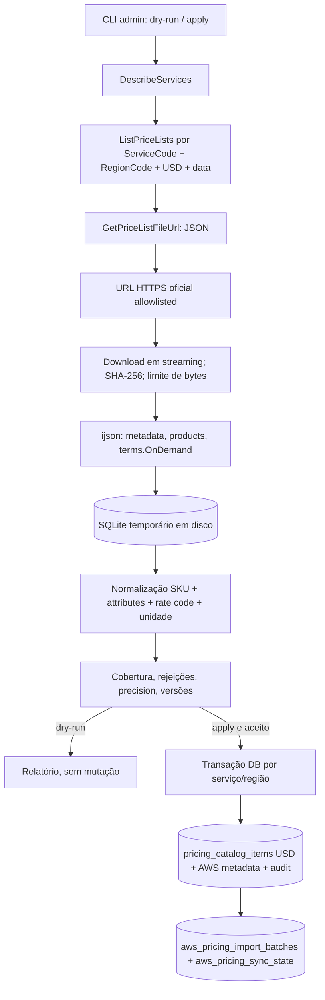

# Task 28.3 — AWS Official Pricing Import Engine

**Status:** implementação entregue em branch e PR; homologação de preço público real e carga de produção **não realizadas**.  
**Fundação:** Task 28.2 (migration `0040_aws_regional_pricing`, `AwsRegionalPricingRepository`, `AwsRegionalPricingResolver`).  
**Escopo:** fonte oficial, ingestão, validação, persistência USD por região e comando administrativo — **sem** cron, UI, Calculadora ou Políticas integradas.

## 1. Desenho efetivo



O arquivo **não** é convertido em objeto JSON único em RAM. `ijson.kvitems` percorre produtos e termos separadamente, gravando um subconjunto admissível em SQLite local, com limite de bytes/produtos/tarifas. A publicação usa o repositório da 28.2 e uma transação por **serviço × região**, nunca uma transação global da AWS. A implementação deliberadamente limita a unidade de importação para evitar recursos ilimitados; um catálogo muito grande falha de modo explícito e deverá ser dividido com staging transacional em evolução futura.

Arquivos:
- `backend/app/services/aws_pricing_bulk.py`: fontes oficiais, descoberta, download, streaming, checksum, staging;
- `backend/app/services/aws_pricing_normalization.py`: reconhecimento conservador de serviços/famílias, identidade financeira, unidades e cobertura;
- `backend/app/services/aws_pricing_import.py`: dry-run, verificação de conflitos, publicação, idempotência, último estado válido;
- `backend/app/commands/aws_pricing_import.py`: operação administrativa;
- `backend/app/tests/test_aws_official_pricing_import.py`: testes offline.

## 2. Fontes oficiais, endpoints e segurança

Fonte primária: [AWS Price List Bulk API](https://docs.aws.amazon.com/awsaccountbilling/latest/aboutv2/using-the-aws-price-list-bulk-api.html), via `DescribeServices`, `ListPriceLists`, `GetPriceListFileUrl`, seguida de download do arquivo `json` autorizado.

O endpoint da API fica em `us-east-1` por padrão (alternativas explicitamente permitidas `eu-central-1` e `ap-south-1`). Isso **não determina** a região do produto: `RegionCode` é filtro explícito e produto de outra região é rejeitado. Sem fallback de região. A paginação de descoberta é limitada; ausência, múltiplas referências contraditórias ou erro de permissão não geram tarifa substituta.

Somente `https://pricing.{us-east-1,eu-central-1,ap-south-1}.amazonaws.com/offers/v1.0/aws/<service>/...` é aceito para download. Redirects são proibidos. É intencionalmente restritivo: URLs oficiais que utilizem outro host exigem revisão explícita da allowlist, não habilitação genérica. `requests` faz streaming com timeout, retry limitado para falhas transitórias e limite de bytes. SHA-256 é calculado sobre os bytes recebidos.

A identidade AWS é a **credencial padrão do backend** (IAM role/chain), **não** a role da conta do cliente. São necessárias permissões `pricing:DescribeServices`, `pricing:ListPriceLists` e `pricing:GetPriceListFileUrl`; egress HTTPS/DNS para download. Não guardar segredo em logs, não criar recursos AWS e não configurar novas credenciais neste PR.

## 3. Serviços e normalização

| ServiceCode oficial | Componentes normalizados | Critérios preservados / limitações |
|---|---|---|
| `AmazonEC2` | `ec2`, `ebs`, `snapshot` e `ipv4` quando inequivocamente publicado | EC2 Linux/Windows Shared On-Demand; instância/SKU, OS, software, tenancy, operação; EBS gp2/gp3/io1/io2/st1/sc1; capacidade, IOPS e throughput separadas |
| `AmazonRDS` | `rds` | PostgreSQL/MySQL/MariaDB; instância, engine, deployment option, licença; armazenamento gp2/gp3 quando metadados/unidades permitem diferenciar |
| `AWSELB` | `alb`, `nlb`, `clb` | Hora-base, LCU/NLCU reconhecidas; tipos sem sinal explícito não classificados por suposição |
| `AmazonVPC` | `ipv4` | Endereços IPv4 públicos apenas se `usagetype` identificar a modalidade |

A classificação é fail-closed: ofertas obscuras e combinações de produto não suportadas não são convertidas em custos estimados. Nem todo produto da AWS possui sinal seguro nos atributos. A extensão `aws_pricing_products` mantém atributos técnicos originais e subconjunto financeiro autorizado. A tarifa guarda `rate_code`, `term_code`, faixa, unidade AWS, início de vigência, fonte e lote; dinheiro **apenas** em `pricing_catalog_items`.

**Unidades mapeadas:** `Hrs` (instância, LB ou IP de acordo com serviço); `GB-Mo` (`GB_MONTH`), `IOPS-Mo` (`IOPS_MONTH`), `MBps-Mo` (`MBPS_MONTH`), `LCU-Hrs` (`LCU_HOUR`) e `NLCU-Hrs` (`NLCU_HOUR`). Não se convertem meses em horas na importação. Unidades desconhecidas são rejeitadas e contam na cobertura.

**Termos comerciais:** somente `terms.OnDemand`. Reserved, Savings Plans, ofertas contratuais e FX/BRL não são importados como On-Demand. Faixas diferentes de `0..Inf` são persistidas com `pricing_status=unsupported` e `enabled=False`, nunca interpretadas como taxa simples. USD `0` válido é preço, não ausência; preços faltantes são rejeitados, sem zero fictício. `Decimal` é obrigatório e tarifa com mais de oito casas significativas é rejeitada por causa de `NUMERIC(20,8)`; **não há arredondamento automático**.

## 4. Versões, idempotência, falha e auditoria

Chave de lote: `(service_code, region_code, source_version, SHA-256)`. A mesma versão já publicada é reportada como `already_published` e não gera novas tarifas/auditoria. Produto repetido usa SKU oficial e compara atributos financeiros. Nova tarifa usa `product_sku:rate_code` com `effective_from`; uma versão posterior com efetividade distinta fecha apenas o intervalo anterior, conservando seu valor e a auditoria. Tarifa contraditória na mesma data, retroatividade ou conflito de SKU abortam a publicação. Não inventamos vigência substituta.

A publicação é atômica na unidade serviço-região: `put_product`, `put_rate`, auditoria e atualização de `aws_pricing_sync_state` pertencem à mesma transação. Se a unidade falha, rollback integral; uma transação posterior registra tentativa `failed` com resumo sanitizado, mantendo `last_successful_batch_id` e catálogo anterior. O estado de execução pode ser `partial` mesmo sem exceção — ausência de cobertura **não** equivale a sucesso financeiro.

A cobertura esperada inclui EC2 Linux/Windows, famílias EBS e dimensões relevantes, snapshots, RDS por engine + gp2/gp3, IPv4, ALB/NLB e unidades de capacidade. `coverage.complete` só é verdadeiro quando todos os componentes mínimos identificados para o ServiceCode estão presentes com tarifa linear reconhecida. Rejeições também impedem status de sincronização integral.

**Padrão:** faltando componentes/rejeições, marca lote `partial` e **não publica preços**. Com `--allow-partial`, pode publicar cobertura parcial **somente se o catálogo regional desses serviços estiver vazio**; permanece marcado `partial` e não é tratado como último sucesso. Nunca substituir uma carga anterior com parcial. Essa opção é de homologação controlada, não de carga normal.

## 5. Operação manual

Executar somente em container do backend com schema/migration 0040 aplicada. O usuário de SO e o ambiente de execução precisam ser administrativos; não há rota HTTP de importação.

```bash
cd backend
python -m app.commands.aws_pricing_import --service AmazonEC2 --region sa-east-1 --dry-run
python -m app.commands.aws_pricing_import --service AmazonRDS --region us-east-1 --dry-run
python -m app.commands.aws_pricing_import --service AWSELB --region sa-east-1 --dry-run

AVEN_AWS_PRICING_IMPORT_ENABLED=1 \
python -m app.commands.aws_pricing_import --service AmazonEC2 --region sa-east-1 --apply
```

Parâmetros: `--effective-at 2026-11-13T00:00:00Z`, `--pricing-endpoint us-east-1`, `--max-bytes`, `--max-products`, `--max-rates`, `--allow-partial`. Modo `--dry-run` descobre, baixa, valida, normaliza e verifica conflitos no banco em **leitura**, sem persistir. Resumo JSON apresenta status, quantidade e motivo de rejeições, componentes presentes/ausentes, batch e versão. Exit code `0`: validado/publicado/idempotente; `2`: cobertura parcial; `3`: falha operacional.

Para validar sem conectividade AWS, usar `--fixture caminho.json --dry-run --offline-dry-run`; nesse modo, o resumo avisa que a checagem de conflitos com o banco não foi realizada. Uma publicação de **fixture** exige simultaneamente `--apply --allow-fixture-apply`, `AVEN_AWS_PRICING_IMPORT_ENABLED=1` e `AVEN_ALLOW_OFFLINE_PRICE_FIXTURES=1`. Não habilitar esses controles em produção.

Recomendação de carga inicial, após homologação: `sa-east-1`, `us-east-1` e regiões ativas nas contas integradas, **uma região e um serviço por execução**. Não automatizar nesta task.

## 6. Testes e validação financeira

Teste de formato: arquivo sintético que reproduz estrutura `aws_v1` (`formatVersion`, `offerCode`, `version`, `products`, `terms.OnDemand`); os valores são **sintéticos, não preços oficiais homologados**. Casos: descoberta e região, origem autorizada, estrutura inválida, granularidade, ijson/disco, USD/zero/decimal, tier, rejeição, idempotência, evolução de vigência, rollback, último estado bom, dry-run, ausência regional e regressão com banco.

```bash
cd backend
ruff check .
ruff format --check .
pytest -q app/tests/test_aws_official_pricing_import.py
pytest -q
```

A suite existente da 28.2 inclui testes PostgreSQL 17 de GiST/exclusão de vigência, migração e compatibilidade OCI. O cenário real deve ser executado em staging após validação de permissões da API, e deve comparar amostras de SKU, Rate Code, unidade, preço exato, vigência, região, moeda e origem diretamente com os arquivos baixados. **Não declarar preço/serviço homologado com base em fixture.**

## 7. Limites conhecidos e entrada da Task 28.4

- A cobertura e normalização são **conservadoras**: preço de IPv4, snapshots e LB só é publicado quando a forma exata é reconhecida. CLB, classes de snapshot e variantes regionais podem permanecer pendentes. Uma fonte oficial diferente dos quatro ServiceCodes mapeados deve ser suportada somente após análise real do contrato.
- Catálogo grande exige espaço temporário em disco e operação dimensionada; ao superar `max_bytes/max_products/max_rates`, falha explicitamente. Transação de publicação é por unidade serviço/região, não por lote interno confirmável: para grandes catálogos, desenhar camada persistente de staging e publicação controlada antes de ampliar limites.
- Conflito de mesma identidade/mesma data com preço alterado requer reconciliação específica. Não alterar `effectiveDate` artificialmente.
- `NUMERIC(20,8)` não cobre tarifas AWS com mais de oito casas significativas; avaliar migração de escala com testes OCI e financeiros antes de ampliar a ingestão.
- O mapping de componentes depende de atributos efetivamente publicados; sem importação AWS live, não há comprovação de cobertura completa por região.
- Task 28.4 pode reutilizar `import_aws_prices`, `StageStats`, batch, sync state e métricas para agendamento, retry/checkpoints, staleness e observabilidade. Nesta task **não há scheduler, endpoint público ou cutover**.

**Estado operacional desta entrega:** não foram acessados IAM, rede AWS nem o PostgreSQL de produção; nenhum catálogo real importado ou custo AWS modificado em produção.
