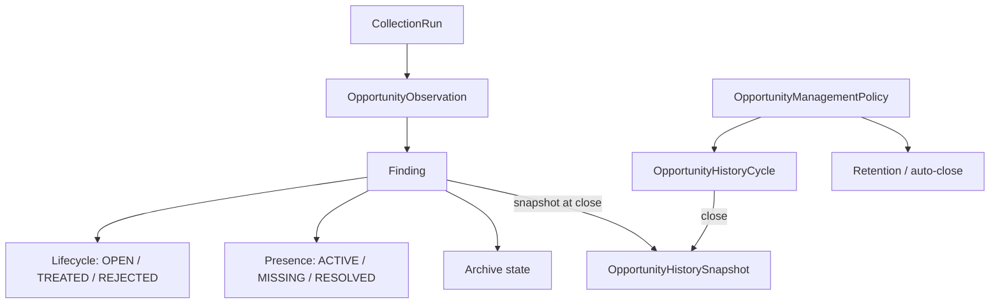

# Task 24.13 — Phase 24 integrated readiness

## Scope

This document consolidates the architecture, operational invariants, migration expectations, deployment order, and manual production-readiness checks introduced by Phase 24. It intentionally does not create a new feature set; it records the contracts that the integrated system must preserve.

## Phase 24 inventory

| Task | Area | Main model/data | API / backend | Frontend | Worker / runtime | Migration | Principal automated coverage |
| --- | --- | --- | --- | --- | --- | --- | --- |
| 24.1 | HTTPS/TLS | persisted HTTPS settings and certificate material | candidate validation, local/public diagnostics, rollback | Settings / HTTPS | Caddy configuration and persistence | — | TLS chain, SAN/key/expiry, redirect, rollback, permissions |
| 24.2 | Audit foundation | `AuditEvent`, actor snapshot, before/after/changes | audit recording and sanitization | audit consumers | transaction-bound recording | `0031` | sanitization, actor snapshot, rollback |
| 24.3 | Administrative audit | `AuditEvent` + `SecurityEvent` read model | unified search/filter/pagination | Audit workspace | — | — | actor/subject search, filters, global pagination |
| 24.4 | Persistent REJECTED | `Finding` lifecycle metadata | reject/reopen semantics | Opportunities lifecycle actions | collection persistence must not reopen rejected | — | rediscovery suppression, explicit reopen |
| 24.5 | Historical cycles | `OpportunityHistoryCycle`, `OpportunityHistorySnapshot` | cycle close and immutable snapshot reads | History | cycle close orchestration | `0032` | overlap, idempotency, immutability, currency separation |
| 24.6 | Operational archive | archive fields/history | individual, bulk, by-filter, preview, period close | archive/history actions | transactional bulk close | — | empty-filter guard, atomicity, correlation/audit |
| 24.7 | Persisted policy | `OpportunityManagementPolicy` | policy read/update/preview, optimistic locking | Settings / Opportunities | auto-close and retention consume persisted policy | `0033` | bootstrap, defaults, version conflict, auto-close |
| 24.8 | Discovery provenance | `Finding.first_seen_collection_run_id`, `last_seen_collection_run_id` | temporal/discovery filters | Opportunities presets/filters | collection persistence updates provenance | `0034` | first/last seen, backfill edge cases, semi-open filters |
| 24.9 | Collections → Opportunities | `CollectionRun`, `OpportunityObservation` | observed/first_seen/reappeared/continued/no_longer comparison | Collection detail and deep links | coverage semantics | — | category disjointness, baseline/coverage, deep-link parity |
| 24.10 | Executive dashboard | dashboard summary read model | backlog/savings/dimensions aggregation | executive Dashboard | summary refresh | — | current backlog, multi-currency, bounded queries |
| 24.11 | Conditional failure insight | latest execution state | operational insight endpoint | conditional Dashboard insight | collection execution state | — | FAILED/SUCCESS/RUNNING transitions |
| 24.12 | New-vs-previous KPI | frozen comparison context | dashboard KPI + exact Opportunities query context | KPI deep link | comparison context retention | — | count/list parity, multi-account, baseline and expiry semantics |

## Conceptual model

`Finding` is the current logical opportunity. `OpportunityObservation` records that the logical opportunity was observed in a collection. Archive is an operational visibility state, not a lifecycle state. A CLOSED cycle owns immutable snapshots representing the historical state at close time.

## Business invariants

- A `REJECTED` opportunity returns to `OPEN` only through explicit reopen. Rediscovery may create a new observation and reactivate technical presence, but must not auto-reopen or auto-unarchive it.
- A `TREATED` opportunity may enter `needs_review` and follow the defined treated rediscovery policy; the special protection for `REJECTED` must not leak into treated semantics.
- Archive does not mutate lifecycle by itself.
- A new `OpportunityObservation` is not a new logical opportunity.
- `first_seen_at` and `first_seen_collection_run_id` are stable provenance. `last_seen_*` advances with valid newer observations.
- `new_vs_previous` is a run comparison, not a synonym for `first_seen`; where applicable it is the disjoint union of first-seen and reappeared opportunities.
- `continued` is target ∩ baseline and is disjoint from `new_vs_previous`.
- `no_longer_detected` is valid only for comparable covered scopes. Failed or uncovered collection scope never proves absence.
- CLOSED cycle boundaries and snapshots are immutable. Snapshot generation is unique per cycle/opportunity and cycle close is idempotent.
- Observation cleanup may remove retained raw observations but must never remove or mutate historical snapshots.
- Monetary totals remain partitioned by currency unless an explicit conversion contract is introduced.
- Audit events are transaction-bound and sanitized; secrets and private key material are never valid audit payload data.
- Empty bulk filters never silently mean “all”; destructive all-scope operations require explicit confirmation.

## Migration and data contracts

### Chain

The production migration head for Phase 24 is `0034_opportunity_discovery_runs`. Fresh installation must reach the same head as an upgrade from a pre-Phase-24 database.

### 0034 discovery provenance backfill

For a Finding with historical observations:

- first run is selected by `observed_at ASC`, then `CollectionRun.started_at ASC`, then observation id as deterministic tie-break;
- last run is the equivalent descending selection;
- an observation that cannot be joined to a real CollectionRun cannot invent a run marker;
- a Finding without usable observations keeps both run markers `NULL`.

No migration attempts to fabricate old monthly history snapshots.

### Persisted opportunity policy

The global policy is created once. Bootstrap compatibility environment values are used only when the first persisted row is created; after that, Settings > Opportunities is authoritative.

Canonical bootstrap defaults are:

- treated archive: 30 days;
- rejected archive: 30 days;
- resolved-externally archive: 30 days;
- observation retention: 400 days.

Changing environment variables after the persisted policy exists does not silently rewrite that policy.

## Configuration classification

| Variable family | Classification | Notes |
| --- | --- | --- |
| `OPPORTUNITY_RETENTION_*` | bootstrap-only compatibility | seeds first persisted global policy; retained for migration compatibility |
| `NUVEMIQ_OPPORTUNITY_OBSERVATION_RETENTION_DAYS` | bootstrap-only for policy value | cleanup consumes persisted policy after bootstrap |
| `NUVEMIQ_RETENTION_ENABLED` | active runtime safety switch | can disable cleanup execution globally |
| `NUVEMIQ_RETENTION_BATCH_SIZE` / `NUVEMIQ_RETENTION_MAX_ROWS_PER_RUN` | active runtime controls | bound cleanup batches independently of policy duration |
| HTTPS/TLS public URL and secure-cookie settings | active runtime | deployment-facing settings; private key material is not exposed through API/audit |

## Retention, history, and database growth

Primary growth drivers are `AuditEvent`, `OpportunityObservation`, `OpportunityHistorySnapshot`, and archive history. Observation retention bounds raw discovery history; snapshot and audit retention are deliberately not introduced by Task 24.13. Operators must therefore monitor database growth for long-running installations, especially when collection frequency, account count, opportunity cardinality, or administrative mutation volume increases.

Cycle close and retention must remain batch-oriented and transactionally safe. Multi-worker execution must use the existing locking/transaction boundaries so a cycle, archive mutation, or cleanup batch is not applied twice.

## Security contracts

- Authorization is enforced server-side for policy, archive/bulk, cycle close, TLS, Audit, previews, and user search.
- Deep links and comparison contexts do not bypass account scope authorization.
- PATCH/PUT schemas do not accept internal lifecycle, actor, policy-version, snapshot, or audit fields through mass assignment.
- Search/sort/action/module/timezone inputs are validated and are not interpolated into raw SQL.
- TLS private keys must not appear in API responses, persisted frontend state, logs, audit payloads, or error traces; file permissions are restrictive and Caddy Admin remains internal.
- Bulk audit payloads record bounded summaries/counts rather than unbounded identifier lists.

## Dashboard and comparison consistency

Dashboard open count, savings, severity, provider, account, service, and rule aggregations use the same operational backlog universe. Archived and rejected opportunities are excluded from actionable backlog metrics. Currencies remain separate.

`new_since_previous` exposes a frozen comparison context. The count displayed by Dashboard and the exact Opportunities deep link are one contract; adding a newer collection must not silently reinterpret an old link while its underlying retained data still exists. When required retained detail has expired, the API returns an explicit expiry state rather than a false zero.

## Deployment and rollback notes

Recommended order for the current Compose architecture:

1. back up PostgreSQL;
2. apply migrations to the target release head;
3. deploy API;
4. deploy worker;
5. deploy web;
6. deploy/reload proxy when TLS/proxy material changed;
7. verify health/readiness, migration head, worker loop, Dashboard and collection smoke paths.

Application rollback after schema migration must be treated separately from database rollback. An older application image may not understand newer response/model contracts even when migrations are additive. Do not assume application rollback is safe solely because containers can be recreated. Preserve database backup and release artifacts before production migration.

Large production backfills must remain set-based/batched; avoid Python row-by-row migration work inside a long transaction. The 0034 provenance backfill is SQL-based and indexed for the joined identifiers used by the new fields.

## Operational runbook

### HTTPS

1. stage candidate leaf certificate, intermediate chain, and matching private key separately;
2. validate key match, SAN, validity and chain before activating;
3. verify Caddy can load the candidate;
4. keep previous persisted configuration until the candidate passes;
5. distinguish local TLS success from DNS/public endpoint/trust validation;
6. verify HTTP redirects to HTTPS and HTTPS serves the application;
7. on failure, retain the known-good configuration and remove failed candidate material.

### Collections

Use CollectionRun detail for observed/first seen/reappeared/continued/no-longer counts. Treat FAILED runs and partial coverage as incomplete evidence, not proof that resources disappeared. Deep links should carry the exact target/baseline context.

### Lifecycle/history

Use reject for durable suppression, reopen for explicit return to backlog, archive for operational visibility, and period close to freeze a cycle snapshot. Never edit historical snapshots to match the current Finding.

### Retention

Use policy preview before reducing retention. Saving a shorter retention value does not purge synchronously; a later worker cleanup applies it. Confirm historical snapshots remain queryable after cleanup.

### Audit

Use the unified Audit view to search security and administrative events by actor/subject and filters. Historical actor snapshot values are authoritative even when the current user record changes.

## Manual QA checklist

The automated suite covers the domain and API contracts. Before production exposure, complete these environment-dependent checks in staging/production:

### TLS

- [ ] Apply a real custom certificate/chain for the deployment domain.
- [ ] Confirm browser trust and SAN for the public hostname.
- [ ] Confirm HTTP → HTTPS redirect from an external client.
- [ ] Confirm local/public/DNS/trust statuses are not conflated.

### Audit

- [ ] Perform a representative admin mutation and locate it by actor.
- [ ] Inspect the event detail and confirm no secret/private material is present.

### Opportunities

- [ ] Reject an opportunity, collect again, and confirm it stays rejected/archived as applicable.
- [ ] Explicitly reopen the rejected opportunity and confirm backlog/history/audit update.

### History

- [ ] Close a cycle, change the current Finding, and confirm the closed snapshot is unchanged.
- [ ] Run retention cleanup and confirm the snapshot remains available.

### Collections / Dashboard

- [ ] Open a SUCCESS CollectionRun and follow first-seen/reappeared/continued deep links.
- [ ] Confirm Dashboard new-vs-previous count equals the destination total.
- [ ] Reproduce FAILED → SUCCESS and confirm the operational failure insight appears/disappears correctly.

### Settings

- [ ] Update opportunity policy retention and confirm version/audit behavior.
- [ ] Simulate stale `expected_version` and confirm HTTP 409 rather than silent overwrite.

## Release behavior changes

- `REJECTED` is durably suppressed and does not re-enter backlog through rediscovery.
- Empty archive filters no longer imply “all”.
- History is represented by immutable cycle snapshots rather than treating legacy archive rows as precise monthly snapshots.
- Opportunity policy is persisted and versioned; compatibility environment values only seed initial state.
- Dashboard is executive/opportunity-focused; detailed collection health is not a heavy dependency of the home screen.
- New-vs-previous is a deterministic comparison contract with an exact deep link context.
- Custom TLS separates server leaf, intermediates and private key, and distinguishes local from public validation.

## Known follow-up boundary

The frontend dependency graph can be remediated non-breakingly up to the latest compatible Next 15 lock selected by npm. Any residual advisory for transitive PostCSS that npm reports as requiring a forced Next 16 upgrade must be handled as a separate framework-upgrade task unless an independently compatible patched path becomes available. Task 24.13 must not hide the advisory or force an unvalidated breaking framework migration.
